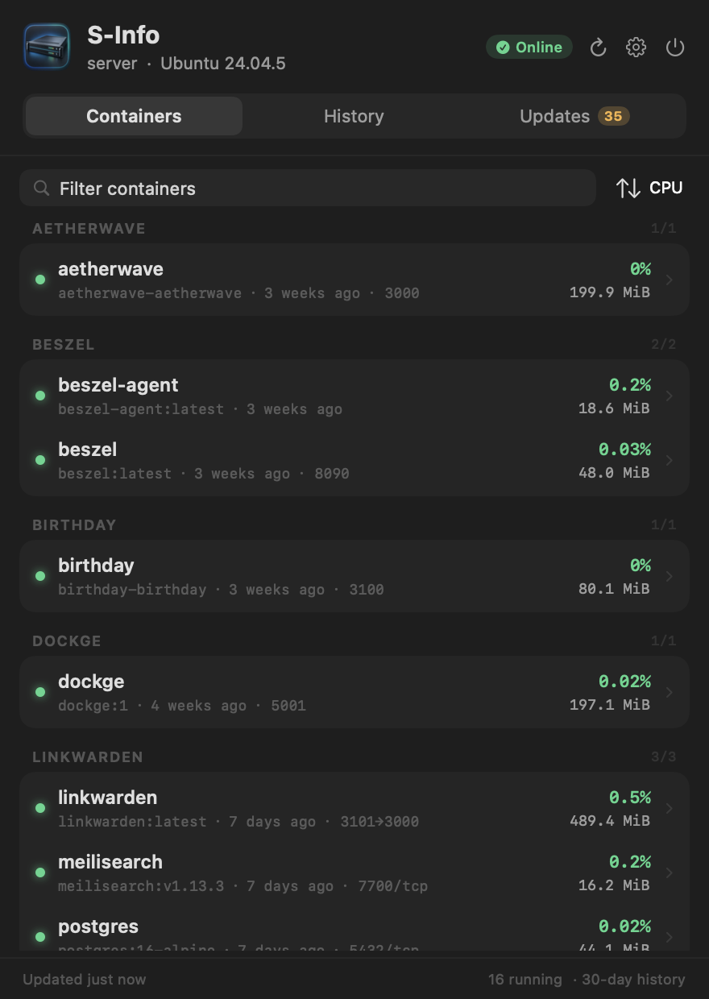
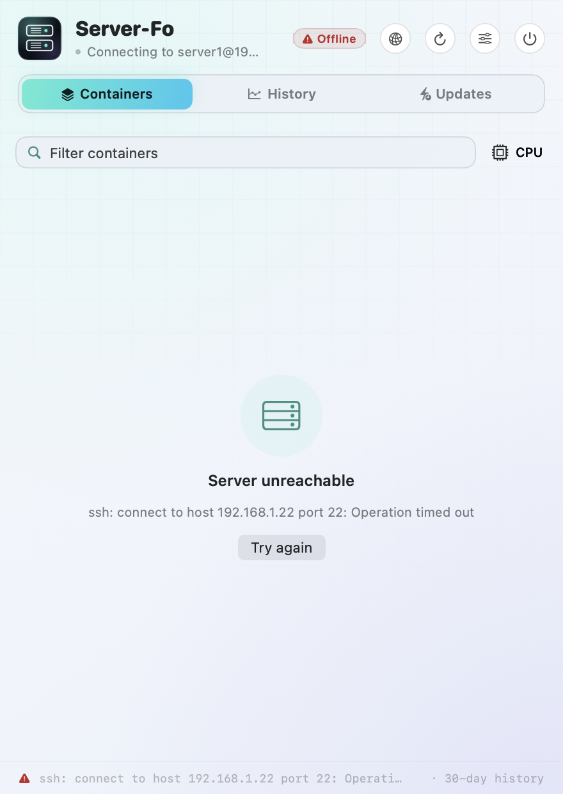
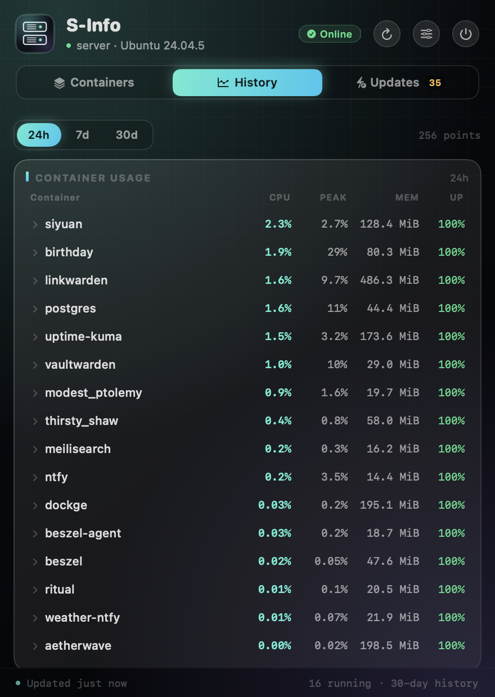
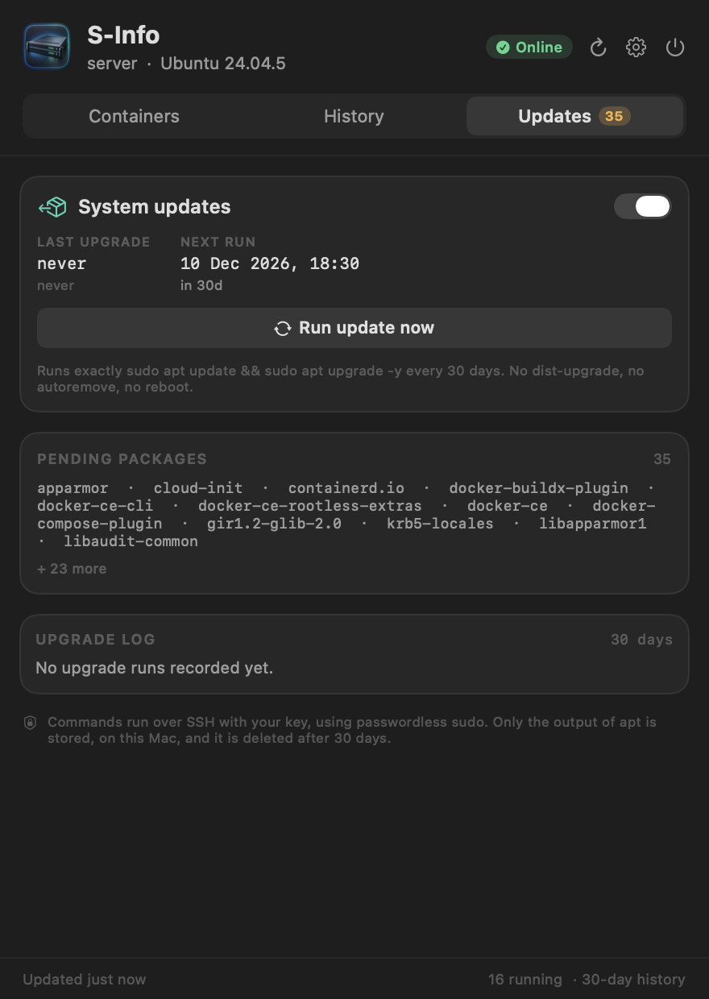
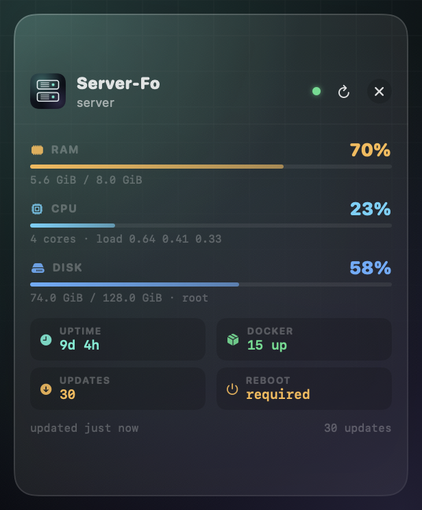
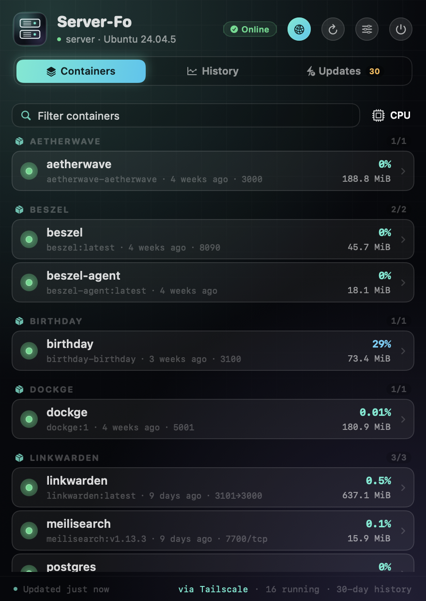
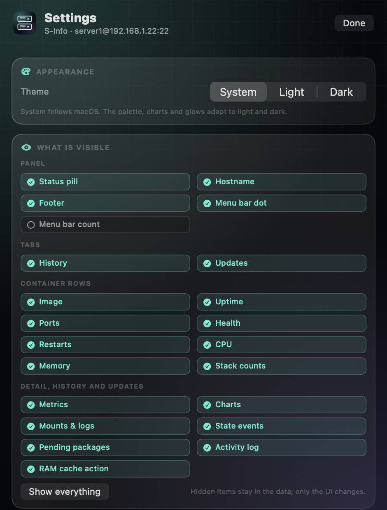

# Server-Fo


A macOS menu bar app for **one server over SSH**: what is running in Docker,
what each application is using, a rolling 30-day history, a scheduled `apt`
upgrade with logs, and a button to clear the server's RAM cache. The interface
follows the system theme, has a light/dark override, and lets you hide anything
you do not want to see.

Server-Fo deliberately does **not** show host CPU, overall RAM, or network totals —
the [dynamic island](https://github.com/Dhivyadhanush/islet) already tracks the
machine. This app answers a narrower question: *which application on the server
is doing what, and is the box up to date?*

> **Formerly S-Info.** The app, bundle and Homebrew cask are now `Server-Fo` /
> `server-fo`. A clean install starts with fresh history and preferences.

<p align="center">
  
  
</p>

## What it shows

**Containers** — every container, grouped by compose stack, with live CPU,
memory used, published ports, image, uptime, health and restart count. Sort by
CPU, memory, name or restarts, or filter by name, image, stack or port.

**Container detail** — per-application figures from `docker stats`: CPU,
memory used (only a real per-container limit is shown, never host RAM), network
rx/tx, block I/O, PIDs and restart policy. Plus the image, command, compose
project and working directory, and on-demand mounts and the last 80 log lines.

**History** — a local SQLite database sampled every 5 minutes: CPU/memory series
per container, start/stop/restart/health events, and every maintenance run. Rolling
**30-day retention** is enforced automatically; older rows are deleted at launch,
hourly while sampling, and after every upgrade.

**Updates** — the pending package list, a reboot-required badge, a RAM cache
action, and one button that runs exactly:

```shell
sudo apt update && sudo apt upgrade -y
```

The same run happens **automatically every 30 days** (on by default), is logged
line by line, and retries the next day if it fails. Nothing else is ever run: no
`dist-upgrade`, no `autoremove`, no reboot.

<p align="center">
  
  
</p>

## Appearance and visibility

- **Theme** follows macOS by default. **Settings → Appearance** can force Light
  or Dark. The gradient canvas, grid, glows, charts and status colours adapt to
  both appearances.
- **Settings → What is visible** controls the panel piece by piece: status pill,
  hostname, footer, menu bar dot and count; the History and Updates tabs;
  image / uptime / ports / health / restarts / CPU / memory / stack counts on
  each container row; detail metrics, charts, mounts & logs; history events,
  pending package list, activity log and the RAM cache action.
- Toggles apply instantly and are remembered. Hidden sections stay in the
  database; only the UI changes. **Show everything** resets the lot.
- The app icon and the menu bar glyph are the same two-unit rack, drawn from one
  shape at build time.

## How it connects

Server-Fo shells out to the system `/usr/bin/ssh` in batch mode with your existing
key. There is no agent, no daemon, no password prompt and no key stored by the
app. The default target is `server1@192.168.1.22`; change it in
**Settings → Connection**.

Requirements:

- macOS 14 or newer.
- SSH key access to the server (the app uses `BatchMode=yes`, so key auth must
  work without a password).
- Docker accessible to that SSH user (`docker ps` without `sudo`, usually via the
  `docker` group).
- Passwordless sudo for the two maintenance actions (`sudo -n true` succeeds):
  `apt` upgrades and the RAM cache drop. Viewing containers and history works
  without it.

New host keys are accepted on first connection
(`StrictHostKeyChecking=accept-new`). Everything runs over one SSH round trip per
refresh, with connection multiplexing kept in `/tmp` for speed.

## Server widget

A small floating card shows the host vitals that the panel deliberately leaves
out: **RAM**, **CPU + load**, **disk**, **uptime**, **Docker counts**, **pending
updates** and the reboot flag. It is always-on-top, draggable, remembers its
position, and updates on the same refresh cycle as the panel.

Enable it with **Settings → General → Show server widget**, or close it with the
X on the card. It appears at login while enabled.



The widget uses the same SSH route as the rest of the app, including the
Tailscale jump host. When the server is unreachable it shows the connection
state instead of stale numbers.

## Tailscale

A globe toggle in the panel header — and the same switch in **Settings →
Connection** — routes the SSH session through Tailscale when you are away from
the server's LAN:

```
Mac  →  pi@100.117.187.32 (Tailscale)  →  server1@192.168.1.22 (LAN)
```

- The Pi only forwards TCP. The Mac still authenticates directly to `server1`,
  so the Pi does not need its own key for the server.
- On enable, Server-Fo reads `tailscale status --json` to find the Raspberry
  Pi's current IPv4 tailnet address and saves it as the jump host. The saved
  address is used if discovery fails (default `100.117.187.32`).
- The route appears in Settings and as `via Tailscale` in the panel footer. The
  detected IP can be refreshed with **Detect Pi IP**.
- Leave it off on the server's LAN; turn it on from anywhere Tailscale reaches
  the Pi. Key-based SSH to the Pi and the Tailscale app running on the Mac are
  required.



## Install

```shell
brew tap Dhivyadhanush/tap
brew trust Dhivyadhanush/tap   # Homebrew asks before loading third-party casks
brew install --cask server-fo
open /Applications/Server-Fo.app
```

The app signs itself ad-hoc, not notarised, so the cask clears the download
quarantine flag after install. Without that, macOS 27 shows “Server-Fo.app Not
Opened” and offers to move the app to the Trash. For a manual download of the
release zip, clear the flag once (or use **System Settings → Privacy & Security
→ Open Anyway**):

```shell
xattr -dr com.apple.quarantine /Applications/Server-Fo.app
```

Then open **Settings** (gear icon) and check:

1. **Host / User / Port** — defaults to `server1@192.168.1.22:22`.
2. **Identity** — leave empty to use your SSH config/agent, or point at a key.
3. **Test connection** — should print `ok <hostname> <kernel>`.
4. **Launch at login** — installed copies add themselves on first launch, so
   sampling and the 30-day schedule are ready when you log in. Turn it off in
   **Settings → General** if you prefer.
5. **Tailscale** — leave the globe toggle off on the LAN; enable it when remote.

### Opening the panel

Server-Fo is a **menu-bar app**: it has no main window. Click the server-rack
icon in the menu bar to open the panel. If the menu bar is full and the icon is
tucked into the overflow, use a menu-bar organizer (Align-MBar, Ice, Bartender)
to pin it, or turn on **Settings → General → Show Dock icon** for an optional
Dock-icon/dashboard fallback.

The Dock icon is **off by default**; the menu bar is the normal entry point.



## History and retention

- One sample every 5 minutes by default (configurable to 1/5/15/30).
- Stored on this Mac: `~/Library/Application Support/Server-Fo/history.sqlite`.
- State changes (start, stop, restart, health) are recorded as events.
- Everything older than **30 days** is deleted automatically. **Prune now** in
  Settings runs the same deletion immediately.
- Nothing is uploaded. The only network calls are SSH to your server and an
  optional read-only GitHub release check.

The app samples while it is running; the menu bar label starts the refresh timer
at login even if the panel has never been opened. If the Mac is asleep at the
due time, the upgrade runs at the first refresh after wake.

## RAM cache

**Updates → RAM cache → Clear cache** runs, after a `sync`:

```shell
sudo -n sh -c 'echo 3 > /proc/sys/vm/drop_caches'
```

This drops clean page cache, dentries and inodes. It does not free memory held
by running applications and restarts nothing; disk reads can be briefly slower
while the kernel rebuilds caches. The run and its output are stored in the local
activity log with the same 30-day retention. It needs passwordless sudo for
`sh`, not only `apt`.

## The 30-day upgrade

The first run is scheduled **30 days after first launch**. A successful run
resets the timer; a failed run retries after 24 hours. The panel shows the last
run, the next run and a countdown. Each run is stored in the local database with
its trigger (manual or scheduled), duration, exit code and output, and is
pruned with everything else after 30 days. Cache clears share the same log.

`apt upgrade` can install a new kernel or library. The app reports
`reboot required` when `/var/run/reboot-required` exists but **never reboots the
server** — that decision stays with you. Docker package upgrades may restart
containers; the app only observes that through the history.

## Command line

Every mode is available without the UI, which makes the app scriptable and
testable:

```shell
S=/Applications/Server-Fo.app/Contents/MacOS/ServerInfo

$S --probe             # one-line summary plus a container table
$S --dump              # the same, with image/stack/ports/IO for each container
$S --history           # retention, DB size and recent state changes
$S --sample            # fetch and write one history sample now
$S --prune             # delete rows older than 30 days
$S --upgrade           # run apt update && apt upgrade -y now, headless
$S --upgrade-if-due    # run only if the 30-day timer says so
$S --clear-cache       # sync and drop the Linux page cache now, headless
$S --update            # check GitHub for a newer release
$S --tailscale on|off  # route through the Pi's Tailscale address, or direct
$S --tailscale-ip      # print the detected Pi tailnet IP
$S --route             # print the active server/jump route
$S --loginitem on|off  # manage the LaunchAgent
$S --selftest          # parser, byte units, schedule and retention tests
```

`--snapshot`, `--snapshot-detail` and `--snapshot-settings` render the UI to PNG
for documentation and visual checks.

To sample from a separate launchd job (for example when the app is not set to
launch at login), point a LaunchAgent at `--sample`; it writes to the same
database, and the app picks the samples up.

## Build

No Xcode project and no packages: `build.sh` compiles all Swift sources with
`swiftc`, links `libsqlite3`, and writes a hand-made `.app`.

```shell
./icon.sh    # regenerates the app icon, menu bar glyph and docs/icon.png
./build.sh
open .build/Server-Fo.app
```

Local builds land in a hidden `.build/` folder, so Spotlight and Launchpad only
ever show the copy installed in `/Applications`.

Command Line Tools on recent macOS releases ship without the SwiftUI macro
plugin, so `build.sh` locates `libSwiftUIMacros.dylib` in the active Xcode
toolchain and passes `-plugin-path` when needed. Build a universal app with:

```shell
ARCHS="arm64 x86_64" VERSION=1.3.3 ./build.sh
```

Layout:

```
Sources/        app, SSH, parsing, SQLite history, views
Resources/      icon generator, generated icns and menu bar glyphs
docs/           screenshots used by this README
build.sh        swiftc + lipo + Info.plist + ad-hoc codesign
.github/        tag-driven release workflow
```

## Security notes

- No credential storage: SSH keys stay in `~/.ssh` / the agent.
- The only stored server data is Docker state, apt output and cache-clear output,
  in the local history database.
- The packaged app is ad-hoc signed and not notarised. Build it yourself if you
  prefer; the source is the whole product.
- Maintenance runs use `sudo -n` (never prompt) and require a working
  passwordless sudo rule. If the rule is absent, the run fails and is logged;
  nothing hangs.

## Troubleshooting

**“Could not reach the server.”** Run `ssh server1@192.168.1.22` in Terminal
first. The app cannot answer a password prompt; set up a key
(`ssh-copy-id`) or an SSH config entry.

**“docker: command not found” or empty list.** The SSH user is not in the
`docker` group, or Docker is not running. `docker ps` in a plain SSH session is
the test.

**Upgrade fails with exit 1.** Confirm the sudo rule with
`ssh server1@… 'sudo -n true'`, then open the run in the activity log to read
the apt error.

**Cache clear fails with exit 1.** The sudo rule does not allow `sh`. Grant it
for `/usr/bin/sh` (or the equivalent) and try again; the error is in the
activity log.

**History panel is empty.** History starts with the first sample. Click
`--sample` or wait for the next 5-minute sample; the app must be running.

**“Server-Fo.app” Not Opened, or the app vanished after the dialog.** Gatekeeper
moved the quarantined copy to the Trash. Reinstall with the current cask
(`brew reinstall --cask server-fo`), which clears quarantine, or run the `xattr`
command above. Nothing is wrong with the app or your data.

## Releasing

```shell
# 1. bump the version in build.sh (default VERSION) and CHANGELOG.md
git commit -am "release v1.3.3"
git tag v1.3.3 && git push --tags

# 2. the release workflow builds a universal zip and publishes the GitHub
#    release with RELEASE_NOTES.md

# 3. if the repository has a TAP_TOKEN secret (a PAT with contents:write on
#    homebrew-tap) the workflow also bumps Casks/server-fo.rb and its checksum;
#    otherwise update that file by hand

# 4. users move with
brew upgrade --cask server-fo
```

Tagging a release needs `TAP_TOKEN` to make step 3 automatic. Without it,
copy the new `sha256` from the release's `.sha256` asset into the tap cask.

## License

MIT. See [LICENSE](LICENSE).
